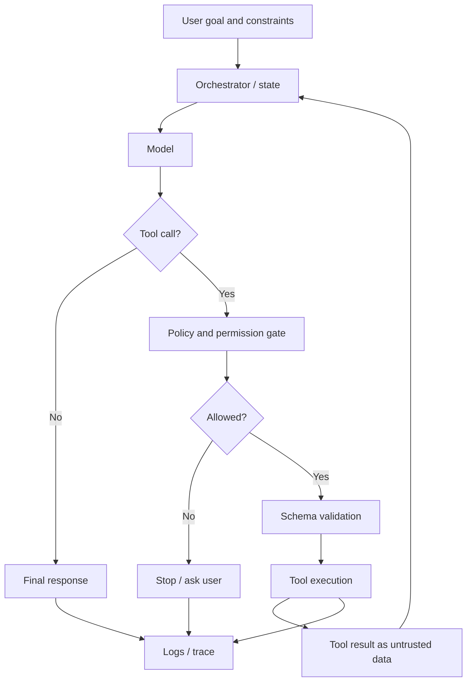

# AI Agent & Tool-Calling Architecture — System Map

## Purpose
Understand how an AI agent decides to use tools, executes actions, manages state, handles errors, and keeps authorization independent from model-generated plans.

## Core architecture

## Agent loop
1. Receive goal, constraints, and risk boundaries.
2. Load scoped context.
3. Ask the model for a response or tool call.
4. Validate tool name, arguments, permission, and risk.
5. Execute within time/resource limits.
6. Return tool result as untrusted data.
7. Update state; continue or stop according to explicit limits.
8. Report what happened, what did not, and uncertainty.

## Building blocks
| Component | Responsibility |
|---|---|
| Model | Reasoning and action proposal |
| Orchestrator | Loop, routing, state, stop conditions |
| Tool registry | Discover tool definitions and schemas |
| Policy layer | Permission, risk, approval, data boundaries |
| Executor | Invoke API, CLI, MCP, or function |
| State store | Conversation, task state, checkpoints |
| Observability | Logs, traces, metrics, evaluation |
| Approval interface | Gate consequential actions |

## Tool contract
Each tool should define:
- Stable name and concise description.
- JSON input schema; validate at runtime.
- Output schema and error model.
- Permission scope and side-effect classification.
- Timeout and retry policy.
- Idempotency behavior.
- Audit metadata and data sensitivity.

## Risk-based policy
| Risk | Example | Default |
|---|---|---|
| Low | Public search, read public docs | Auto within limits |
| Medium | Read private records | Scoped authorization and privacy controls |
| High | Edit data, send messages, publish | Approval or constrained execution |
| Critical | Money transfer, delete data, production changes | Explicit approval; manual-only is often safer |

## Reliability and safety controls
- Allowlist tools; do not expose unrestricted tool discovery in production.
- Validate arguments and outputs.
- Least privilege and separate credentials.
- Timeouts and bounded retries.
- Idempotency for retryable writes.
- Max tool-call count, time, token, and spend budgets.
- Clear stop conditions.
- Audit trail with sensitive-data minimization.
- Treat retrieved content and tool results as untrusted; never let them override policy.
- Use deterministic code/workflows for critical transitions; use AI for ambiguity.

## Failure handling
| Failure | Response |
|---|---|
| Success | Continue loop |
| Timeout | Bounded retry or safe fallback |
| Rate limit | Respect retry guidance; consider alternate provider |
| Permission denied | Stop and ask; never bypass |
| Invalid arguments | Correct once if safe, then stop on repeat |
| Unknown error | Log and report |

## Architecture patterns
- Single agent: simplest baseline and preferred initial build.
- Router: select model/workflow/tool set.
- Plan-and-execute: planning is advisory; revalidate each action.
- Human-in-the-loop: approval for consequential actions.
- Deterministic workflow + AI: critical state transitions in code.
- Multi-agent: use only when decomposition and parallelism justify coordination cost.

## Anti-patterns
- Unrestricted shell or admin credentials.
- Retrieved content treated as instructions.
- Infinite loops or unlimited budgets.
- Blind retries on side-effecting actions.
- Model plan treated as permission.
- All connectors exposed to all agents.
- Sensitive payloads logged by default.

## Build sequence
1. Single agent + one read-only tool.
2. Schemas, permission checks, and risk classification.
3. Logs, limits, timeouts, and stop conditions.
4. Test failures and prompt injection.
5. Add a narrow write action behind approval.
6. Add routing after measured need.
7. Multi-agent only after single-agent bottlenecks are demonstrated.

## Related maps
- [AI assistant stack](ai-assistant-stack.md)
- [MCP ecosystem](mcp-ecosystem.md)
- [Automation ecosystem](automation-ecosystem.md)
- [Cybersecurity fundamentals](cybersecurity-fundamentals.md)
- [Software delivery / DevOps](software-delivery-devops.md)

## Sources
See source records in maps-index.json. Initial official-source audit date: 2026-11-24.

## Status
Draft; initial source review completed. Use source-backed concepts, but verify exact model/API/runtime capabilities before implementing.
