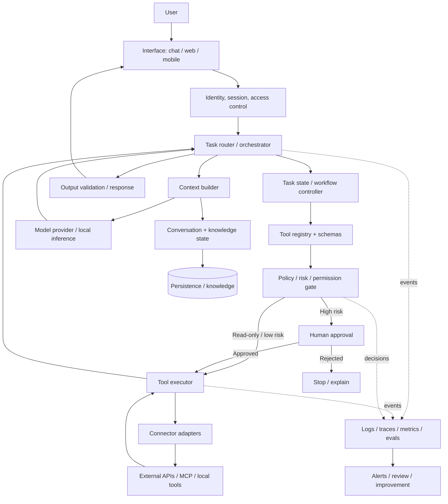

# AI Assistant Stack — Architecture & Decision Map

## Purpose
Design a useful AI assistant as an operable system—not as a chat UI connected to a model. The assistant needs controlled tools, context, state, policy, execution, monitoring, and recovery.

**Recommended default:** start with one assistant, one model, a small read-only tool set, explicit workflow limits, and human approval for consequential actions. Add complexity only when measured need justifies it.

## Architecture

## 1. Core components and responsibility boundaries
| Component | Responsibility | Must not do |
|---|---|---|
| Interface | Input/output, uploads, streaming, user controls | Hold provider secrets or bypass backend permissions |
| Identity & session | Authenticate user, isolate tenants/sessions, session expiry | Treat a prompt as proof of identity |
| Router | Choose workflow, model, or specialist | Grant tools or permission based on model confidence alone |
| Context builder | Select relevant conversation, memory, documents, tool results | Inject entire history without limits or trust boundaries |
| Model | Interpret, reason, generate structured proposals | Execute privileged actions directly |
| Orchestrator | State machine/agent loop, handoffs, retry and stop rules | Infinite loops or unbounded delegation |
| Tool registry | Tool names, schemas, capability, risk, permissions, owner | Expose every tool to every task |
| Policy engine | Validate actor, action, target, data, scope, risk, approval | Rely only on model self-assessment |
| Executor | Execute approved and validated tool calls | Accept unvalidated arguments or unsafe ambient privileges |
| Connector adapter | API-specific authentication, translation, rate limits, errors | Leak secrets to model or logs |
| State & memory | Persist task state and user-approved memory | Store unbounded, sensitive, or untrusted data by default |
| Knowledge/retrieval | Find evidence and source provenance | Treat retrieved text as trusted instructions |
| Observability | Trace model/tool/policy/execution, cost and failures | Log secrets or sensitive payloads indiscriminately |
| Evaluations | Test task quality, tool behavior, safety, regressions | Use only subjective “looks good” review |

## 2. Execution loop (bounded)
1. Authenticate user and create task/session IDs.
2. Parse goal; classify task type, data sensitivity, risk and scope.
3. Retrieve only relevant context; label sources and trust boundaries.
4. Select model/workflow based on task requirements and cost policy.
5. Model returns a response or a structured tool proposal.
6. Validate schema and tool allowlist; normalize arguments.
7. Apply deterministic policy: identity, authorization, target, data scope, risk, budget, and approvals.
8. Execute through a controlled adapter; use timeout and idempotency where appropriate.
9. Return result as untrusted data to the model with provenance and error status.
10. Continue only within step, time, token, tool-call, retry, and spend budgets.
11. Validate final output and cite/reconcile evidence where required.
12. Persist task result, state transitions, and redacted audit events.
13. Stop, report completion, or hand control to a human.

**Loop termination:** success, user cancellation, policy block, approval denial, deadline, budget exhaustion, repeated failure, or explicit stop condition.

## 3. Tool contracts
Every tool should have a controlled contract:
- Stable tool ID and version.
- Short, precise description; define when not to use it.
- Strict input schema; required fields, enums, bounds, and types.
- Output schema or explicit result format.
- Permission scope and data classification.
- Risk tier and side-effect description.
- Timeout, retry, rate-limit, and concurrency policy.
- Idempotency strategy for side-effecting calls.
- Error classes and recoverability.
- Owner, tests, audit requirements, and deprecation path.

Prefer typed, structured results over unbounded text. Return concise status, data, provenance, and error fields. Tool outputs are untrusted, even if they come from a connected service.

## 4. Risk tiers and approvals
| Tier | Examples | Default control |
|---|---|---|
| R0 — Public/read | Search public docs, list non-sensitive resources | Allowlist + rate limits |
| R1 — Private read | Read user's email, files, account or CRM data | Least privilege, user scope, audit; explicit access context |
| R2 — Reversible write | Draft, create a task, modify non-critical record | Preview/diff, scoped permissions; approval depending on context |
| R3 — High impact | Send external message, purchase, payment, deploy, delete, change access, production mutation | Explicit human approval of exact action and arguments; idempotency; audit |
| R4 — Prohibited/unsafe | Actions outside authorization, credential theft, destructive abuse, policy evasion | Block; do not route around controls |

Risk is action/context-specific. An apparently harmless action can be high risk when it affects production, money, identity, sensitive data, or many users. Model confidence does not lower the required authorization.

## 5. Policy gate — deterministic checks
Before execution, verify:
- Authenticated actor and tool identity.
- User's authorization and connector scopes.
- Tool is allowed for this workflow.
- Target is in scope and not an untrusted redirect.
- Arguments conform to schema and bounds.
- Data classification permits the destination.
- Side-effect and risk tier are identified.
- Required approval is present and matches the exact action/arguments.
- Budget, rate limit, timeout, and retry limits remain.
- Idempotency key exists for duplicate-prone writes.
- Execution environment/network/filesystem are isolated where needed.

**Fail closed:** if policy service, approval, identity, or validation is unavailable, do not execute privileged actions.

## 6. Context, memory and retrieval
Separate:
- **Working context:** task inputs, recent turns, current workflow state.
- **User memory:** durable preferences/facts only when useful, authorized and controllable.
- **Knowledge base:** documents, notes, structured data, source-linked facts.
- **Tool results:** transient outputs with provenance, timestamps, and trust labels.

Controls:
- Retrieval relevance, access filtering, source attribution, and freshness.
- Minimize personal/confidential data.
- Memory review, correction, retention, and deletion lifecycle.
- Treat retrieved text as data—not instructions.
- Detect prompt injection in documents, websites, email, and tool outputs.
- Do not let external text grant permissions or override system policy.

## 7. Orchestration patterns
| Pattern | Use when | Complexity / risk |
|---|---|---|
| Single agent + tools | Default for most MVPs | Lowest |
| Deterministic workflow + model steps | Known sequence, predictable operations | Low-medium |
| Router to specialists | Different task types need distinct instructions/tools | Medium |
| Handoff | One specialist has a clear bounded responsibility | Medium |
| Parallel agents | Independent subtasks; results can be reconciled | High |
| Long-running background agent | Task needs durable state, scheduled execution, or delayed completion | High; requires lifecycle, monitoring and cancellation |

Do not begin with multi-agent architecture. Split only when separation of expertise, independent parallelism, context boundaries, or measured performance justify it.

## 8. Reliability and recovery
- Use explicit task state and state transitions.
- Timeouts per model call and tool call.
- Bounded retries with exponential backoff only for retryable errors.
- Circuit breaker for failing dependencies.
- Idempotency for write operations.
- Dead-letter or manual review for unrecoverable tasks.
- Compensation/rollback where possible; not every action is reversible.
- Cancellation and deadline propagation.
- Rate-limit and spend ceilings.
- Validate tool result completeness before proceeding.
- Fallback models/providers must be tested, not assumed equivalent.

## 9. Observability and evaluation
Trace a task end-to-end:
- Task/session/run ID.
- User intent classification and workflow.
- Model/provider/version/settings.
- Context sources and retrieval IDs.
- Tool proposals, schema validation, policy decision, approval, execution result.
- Handoffs, retries, timeouts, stop reason.
- Latency, token usage, cost, accepted outcome.
- Errors and user feedback.

Use redacted logs; secrets and sensitive payloads should not be copied into telemetry by default.

Evaluation should include:
- Task success and correctness.
- Tool selection and argument validity.
- Policy compliance and unsafe-action rate.
- Completion rate, recovery, and latency.
- Cost per accepted task.
- Regression tests and adversarial/prompt-injection cases.
- Human review for consequential outputs.

## 10. Deployment architecture
For a small, low-cost MVP:
- UI → authenticated backend → model API.
- Backend owns API keys, policy, tool registry and executor.
- Separate tool adapters and secrets management.
- Use Postgres or other durable store for sessions/task state when required.
- Start with simple scheduled tasks; introduce queue/worker for asynchronous work.
- Containerize and pin versions; provide health checks.
- Backups and restore test.
- Monitor resource use, latency, error rate and spend.
- Avoid public exposure of admin, model, tool, or database interfaces.

Local inference can reduce external data exposure and recurring API costs, but adds hardware, maintenance, security, and quality tradeoffs.

## 11. MVP sequence and gates
**Phase A — Answer-only**
- Authenticated interface, one provider, basic prompt, no tools.
- Measure response quality, cost, latency, and data handling.

**Phase B — Read-only tools**
- 2–3 tools with strict schemas and scoped permissions.
- Test wrong arguments, access denied, timeout, malformed output and injection.

**Phase C — Controlled writes**
- Draft/preview, exact-action approval, idempotency, audit log.
- No automatic high-impact writes.

**Phase D — Durable workflow**
- Task state, queue/worker if needed, retries, cancellation, observability and evaluation.

**Phase E — Expansion**
- More providers, knowledge retrieval, automation, specialist agents only when justified.

Each phase has a measurable exit gate. Do not move to the next phase because it is technically exciting.

## 12. Design review checklist
- [ ] User and session identity verified.
- [ ] Scope and task risk classified.
- [ ] One model/provider chosen for MVP; fallback tested if required.
- [ ] Tools have stable IDs, strict schemas and descriptions.
- [ ] Least privilege and per-workflow tool allowlists.
- [ ] Deterministic policy gates independent of model.
- [ ] Exact high-risk actions require approval.
- [ ] Context/memory and retrieved data have trust labels.
- [ ] Prompt injection and tool-output attacks tested.
- [ ] Step, time, token, retry and spend budgets set.
- [ ] Idempotency and recovery defined for side effects.
- [ ] Logging redacts sensitive content.
- [ ] Evaluation set, regression tests and stop conditions exist.
- [ ] Backups, monitoring, cancellation and recovery available.
- [ ] Production deployment and public exposure reviewed.

## Source audit — 2026-11-24
- [OpenAI Building Agents](https://developers.openai.com/tracks/building-agents) — core components, tools, orchestration, guardrails, evaluation and best practices.
- [OpenAI Agents Guide](https://developers.openai.com/api/docs/guides/agents) — runtime options and agent workflows.
- [OpenAI Guardrails & Human Review](https://developers.openai.com/api/docs/guides/agents/guardrails-approvals) — validation, approval boundaries, pausing and resuming.
- [OpenAI Observability](https://developers.openai.com/api/docs/guides/agents/integrations-observability) — traces, model/tool/handoff/guardrail events and monitoring.
- [Anthropic Tool Use Overview](https://platform.claude.com/docs/en/agents-and-tools/tool-use/overview) — tool schemas, client/server execution and result handling.

**Audit limitation:** Official documentation spot-check, not a threat model, deployment review, or performance test. Vendor framework recommendations are not independent evidence and should not be treated as universal architecture requirements.

## Related maps
- [Self-hosted AI Assistant](self-hosted-ai-assistant.md)
- [AI Models & Providers](ai-models-providers.md)
- [AI Agent & Tool-Calling Architecture](ai-agent-tool-calling.md)
- [MCP Ecosystem](mcp-ecosystem.md)
- [Cybersecurity Fundamentals](cybersecurity-fundamentals.md)
- [Personal Infrastructure](personal-infrastructure.md)
