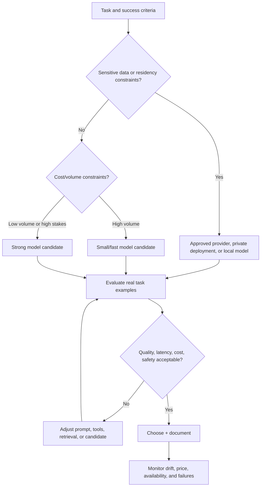

# AI Models & Providers — Decision Map

## Purpose
Select a model/provider for a specific task using measured task performance, total cost, latency, reliability, privacy, tool compatibility, and operational risk—not brand or benchmark ranking alone.

## Model-selection flow


## 1. Define the task before comparing models
Specify:
- **Task:** coding, research, extraction, classification, translation, reasoning, vision, speech, agent/tool use, or generation.
- **Success criteria:** objective correctness, schema validity, citation quality, acceptance rate, or human review score.
- **Failure cost:** what happens if the output is wrong?
- **Constraints:** budget, latency, throughput, context size, modality, privacy, geographic availability, licensing, and deployment environment.
- **Evaluation set:** representative examples, edge cases, and adversarial cases. Use 10–30 examples for an initial screening; increase the set for consequential decisions.

## 2. Capability taxonomy
| Dimension | What to test |
|---|---|
| Text / reasoning | Accuracy, instruction following, uncertainty handling |
| Coding | Correct changes, tests, repository context, debugging |
| Tool calling | Valid calls, argument correctness, recovery from tool failures |
| Structured output | JSON/schema adherence and edge cases |
| Retrieval / long context | Relevant recall, evidence attribution, distraction resistance |
| Vision | OCR, chart/image interpretation, spatial reasoning |
| Audio / realtime | Transcription quality, latency, interruptions, speech output |
| Multilingual | Terminology, translation, dialect and script handling |
| Agentic work | Completion rate, steps, safe behavior, recoverability |
| Speed | Time to first token, total latency, throughput |
| Reliability | Error rate, availability, timeout and rate-limit behavior |

Capabilities must be tested in the exact API, model version, and configuration intended for deployment. A feature listed in a provider's catalog is not a substitute for a test.

## 3. Candidate tiers
Use roles rather than permanent model names:
- **Tier A — High capability:** complex reasoning, difficult coding, research synthesis, consequential work with human review.
- **Tier B — Balanced:** routine coding, agent workflows, document tasks, general production use.
- **Tier C — Low-cost/fast:** classification, extraction, summaries, simple transformations, high-volume tasks.
- **Specialized:** image generation, transcription, realtime audio, embeddings, moderation, vision, or domain-specific models.
- **Local/open-weight:** privacy, control, offline operation, customization, or predictable infrastructure; evaluate hardware, operational cost, license, and quality trade-offs.

## 4. Provider and model due diligence
Before committing, verify from current official documentation:
- Model ID, release/version, lifecycle, deprecation and shutdown dates.
- Input/output modalities and context/output limits.
- Tool/function calling, structured output, reasoning controls, and supported APIs.
- Pricing: input, output, cached tokens, reasoning tokens, images/audio/video, tools, batch, and storage.
- Rate limits: RPM, TPM, concurrency, daily quotas, tier eligibility, and how limits are enforced.
- Data handling: retention, training use, privacy controls, region/residency, enterprise terms.
- Availability: supported regions, account access, payment, and API restrictions.
- Service status, incident history where relevant, support, and SLA.
- Terms, license, acceptable use, and deployment restrictions.
- Migration path and compatibility if a model is retired.

## 5. Total cost of ownership (TCO)
Do not compare token prices alone.

```
Estimated total cost =
  input tokens × input rate
+ output tokens × output rate
+ cached-token charges
+ reasoning-token charges (if separately billed)
+ tool / grounding / search charges
+ image / audio / video charges
+ hosting, GPU, storage, and networking (local/self-hosted)
+ evaluation, human review, and failure-recovery cost
```

Measure **cost per accepted task** as a more useful metric:
```
Cost per accepted task = total evaluation/deployment cost ÷ accepted outputs
```
If a cheaper model needs more retries, corrections, or human review, it may be more expensive overall.

## 6. Benchmark and evaluation method
1. Select candidates from the current official catalog.
2. Pin model/version and settings where possible.
3. Use identical task inputs, instructions, tools, and evaluation rules.
4. Score correctness, completeness, format, tool success, latency, and cost.
5. Record failure examples; aggregate scores can hide catastrophic edge cases.
6. Test repeated runs for stochastic variability.
7. Run a small real-world pilot and compare to a baseline.
8. Keep the least expensive candidate that reliably meets the acceptance threshold.
9. Re-evaluate after major model, prompt, tool, or workflow changes.

**Do not rely on one benchmark score.** Benchmarks may have contamination, task mismatch, differing test conditions, and optimization artifacts. User-specific evaluations are more decision-relevant.

## 7. Routing and fallback
A practical routing pattern:
- Route routine tasks to Tier C/B.
- Escalate only when confidence, complexity, or failure signals justify it.
- Route sensitive tasks only to approved environments.
- Use specialized models when modality or task makes them materially better.
- Keep a fallback provider/model for outage, rate limits, or retirement.
- Fallbacks must be evaluated too; they are not assumed equivalent.

Routing must have bounded retries, spend limits, timeouts, and explicit stop conditions. Avoid infinite escalation loops.

## 8. Vendor lock-in controls
- Keep provider-specific calls behind a small adapter/interface.
- Use portable task definitions and schemas where practical.
- Record model IDs and settings for reproducibility.
- Separate prompts, tool contracts, evaluation data, and routing policy from vendor SDK logic.
- Avoid assuming identical tool-call behavior across providers.
- Maintain tested fallback configurations.
- Keep migration notes for incompatible API/model changes.

## 9. Privacy and security
- Classify data before sending it to a model.
- Minimize or redact personal, confidential, and proprietary information.
- Verify data retention, training, and regional terms for the actual account/API tier.
- Treat model output and tool-call arguments as untrusted.
- Require human approval for consequential, external, financial, destructive, or irreversible actions.
- Do not expose secrets in prompts, logs, or evaluation data.
- For local/open-weight deployment, secure the host, weights, endpoints, and logs; local does not automatically mean safe.

## 10. Decision record template
| Field | Record |
|---|---|
| Use case / owner | |
| Task and acceptance criteria | |
| Data sensitivity | |
| Candidates and exact model IDs | |
| API / version / settings | |
| Evaluation set and date | |
| Quality / failure results | |
| Latency / throughput | |
| Cost per accepted task | |
| Rate limits / availability | |
| Privacy / licensing review | |
| Selected candidate and rationale | |
| Fallback | |
| Approval / human review | |
| Re-test trigger and date | |

## 11. Review triggers
Review immediately when:
- Model ID changes, is deprecated, or receives a shutdown date.
- Pricing, quota, context, tool, or data terms change.
- The provider reports an incident or reliability degrades.
- Workload, data sensitivity, or volume changes.
- Evaluation performance or cost per accepted task shifts materially.

Suggested review cadence:
- **Volatile facts:** 30–90 days, or before deployment.
- **Architecture and evaluation framework:** 180 days.
- **Consequential production deployments:** continuous monitoring plus change-triggered re-evaluation.

## Source audit — 2026-11-24
Official documentation spot-checked:
- [OpenAI Models catalog](https://developers.openai.com/api/docs/models) — model identities, capability and specification listings.
- [OpenAI Model selection guide](https://developers.openai.com/api/docs/guides/model-selection) — use-case fit and evaluation guidance; provider recommendations are not independent benchmarks.
- [OpenAI API changelog](https://developers.openai.com/api/docs/changelog) — model and API changes, migration and deprecation notices.
- [Google Gemini API pricing](https://ai.google.dev/gemini-api/docs/pricing) — pricing tiers, model-specific charges, quotas and data-use distinctions.

**Audit limitation:** This is a framework-level spot-check, not a complete provider comparison. Pricing, exact model capabilities, account/region availability, and terms are volatile. Verify the live official documentation for the target model before use; this map intentionally does not preserve prices as evergreen facts.

## Related maps
- [AI Assistant Stack](ai-assistant-stack.md)
- [Self-hosted AI Assistant](self-hosted-ai-assistant.md)
- [AI Agent & Tool-Calling Architecture](ai-agent-tool-calling.md)
- [MCP Ecosystem](mcp-ecosystem.md)
- [Cybersecurity Fundamentals](cybersecurity-fundamentals.md)
