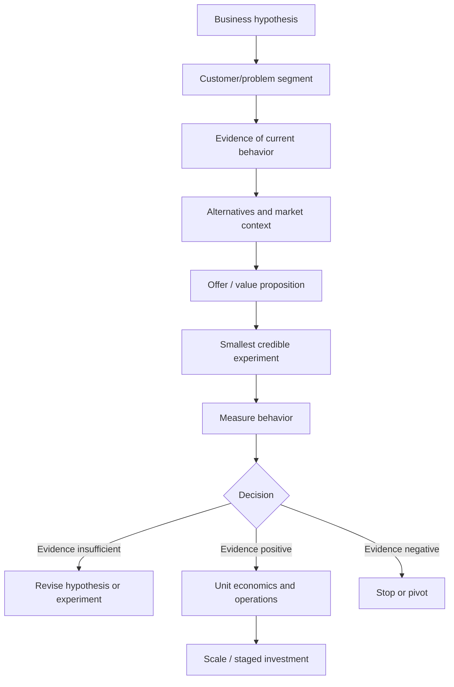

# Business Validation — Evidence-Driven Map

## Goal
Reduce the risk of spending time, capital, and effort on an idea before there is credible evidence of customer demand, viable economics, and operational feasibility.

## Validation loop

## 1. Define testable hypotheses
Separate:
- **Customer:** a narrowly described segment with access.
- **Problem:** specific pain, frequency, severity, and current workaround.
- **Value:** what outcome improves and how much it matters.
- **Behavior:** current spending, switching, search, or workarounds.
- **Offer:** product, price, delivery, and terms.
- **Channel:** how you can reach and convert customers.
- **Economics:** contribution margin, cash cycle, and acquisition cost.
- **Operations:** ability to deliver quality consistently.

Use falsifiable statements and define success/failure thresholds before the test.

## 2. Market research
Use secondary data for broad, quantifiable context; use direct customer research to resolve questions specific to the target segment. Check:
- Demand and buying behavior
- Segment size and reachable market (not only total population)
- Geography and delivery/access
- Market saturation and competitors
- Substitute products and workarounds
- Price and terms customers currently pay
- Barriers, supplier/customer leverage, and timing

## 3. Customer discovery
Prefer questions about past behavior over hypothetical enthusiasm:
- Tell me about the last time this problem happened.
- What did you do? What did it cost in money, time, risk, or inconvenience?
- Which alternatives did you try and why?
- Who chooses, who pays, and what triggers the purchase?
- What would make you switch? What prevents switching?
- What is the next real purchase or decision date?

Avoid pitching early. Record the customer's exact behavior, evidence, and uncertainty. Interviews are exploratory; do not treat a small convenience sample as market-size proof.

## 4. Evidence ladder — heuristic, not universal
From generally weaker to stronger evidence:
1. Compliments / opinions
2. Stated interest
3. Stated intent at a specific price
4. Existing spend or active workaround
5. Customer invests time/data, schedules a concrete next step, or tests
6. Paid pilot, deposit, purchase order, or completed purchase
7. Repeat purchase, retention, referral, and contribution-positive behavior

Evidence strength depends on context. A paid order may still be unprofitable or non-repeatable.

## 5. Experiment design
For each experiment, write:
- Hypothesis
- Segment and sample/recruitment method
- Experiment and duration
- Cost and risk
- Primary metric
- Threshold for success, failure, and inconclusive result
- Biases and limitations
- Decision triggered

Low-cost options: problem interviews, competitor/price audit, landing page with real CTA, sample/pilot, pre-order where lawful and transparent, concierge/manual delivery, prototype, or paid trial.

## 6. Unit economics
Calculate using conservative assumptions:
- Net realized price after discounts/returns
- Variable materials, packaging, and payment fees
- Direct labor and fulfillment
- Delivery, commissions, and customer support
- Waste, rework, and refunds
- Contribution per unit/order/customer
- Customer acquisition cost and payback, where applicable
- Repeat rate and cohort economics
- Working capital, inventory days, receivable days, payable days

Contribution margin is not net profit. Include fixed costs, taxes, financing, owner labor, and capacity constraints in the scale decision.

## 7. Operations feasibility
Validate:
- Supplier quality, lead time, MOQ, and alternatives
- Process capability and quality requirements
- Regulatory and licensing constraints
- Capacity and bottlenecks
- Delivery/service reliability
- Cash requirements and failure modes

## 8. Decision gates
- **Stop:** problem/demand evidence is weak, economics fail, or risk is unacceptable.
- **Pivot:** evidence reveals a different segment, problem, offer, or channel.
- **Continue test:** uncertainty remains but test is affordable and decision-relevant.
- **Pilot:** credible behavior and feasible delivery; limit exposure.
- **Scale:** repeatable demand, contribution-positive economics, operations, and risk controls demonstrated.

## 9. Anti-bias rules
- Set thresholds before collecting results.
- Distinguish observed behavior from stated opinions.
- Report sample size, selection bias, and uncertainty.
- Do not extrapolate a convenience sample to market size.
- Do not use TAM alone as evidence of demand.
- Do not scale on one enthusiastic customer or one non-repeatable sale.

## Related maps
- [Product development](product-development.md)
- [Economics & decision making](economics-decision-making.md)
- [Food manufacturing system](food-manufacturing-system.md)

## Sources
See source records in maps-index.json. SBA guidance supports market demand, market size, location, saturation, pricing, direct research, competitor analysis, and business planning. This map combines those official guidance elements with practical experiment and decision heuristics; the heuristic ladders are not official SBA scoring systems.

## Status
Draft; initial source audit completed. Treat experiment thresholds as context-specific and validate with real customer behavior.
