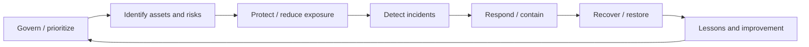

# Cybersecurity Fundamentals — Practical System Map

## Goal
Manage cyber risk proportionately across personal accounts, devices, small-business operations, projects, cloud services, and AI-connected tools. This is a baseline map, not a complete security standard or certification checklist.

## Framework anchor
Use NIST Cybersecurity Framework (CSF) 2.0 as a flexible outcomes-based structure. Its six functions form a continuous cycle:
- **Govern:** establish responsibility, priorities, policies, risk tolerance, and oversight.
- **Identify:** know assets, data, dependencies, threats, and business impact.
- **Protect:** apply safeguards and reduce exposure.
- **Detect:** identify suspicious activity and failures.
- **Respond:** contain, communicate, investigate, and coordinate.
- **Recover:** restore trusted operations and learn.

The framework is not a prescriptive one-size-fits-all control list. Tailor outcomes to asset value, exposure, legal requirements, and available resources.

## Risk cycle

## Asset inventory
Track at least:
- Identity/accounts and recovery methods
- Devices and operating systems
- Domains, DNS, email, and hosting
- Servers, containers, databases, and applications
- Git repositories, source code, CI/CD and deployments
- Secrets, API tokens, and service credentials
- Private files, business records, customer data
- Payment, wallet, and financial systems
- Third-party providers, connectors, and AI tools

## Small operator baseline
| Control area | Minimum practical control |
|---|---|
| Identity | Unique passwords, password manager, MFA on critical accounts |
| Recovery | Secure recovery email/phone; offline recovery codes |
| Admin | Separate admin identity where practical; least privilege |
| Devices | Supported OS, updates, disk encryption, screen lock |
| Network | Expose only required services; firewall; no default admin interfaces open |
| Secrets | Never commit secrets; store securely; rotate and revoke when exposed |
| Software | Prefer maintained products; review permissions, origin, update path |
| Data | Minimize collection; classify; encrypt where appropriate |
| Backups | Independent backup; test restore; define RPO/RTO |
| Monitoring | Review account alerts, logs, domain/DNS, unusual access |
| Incident response | Written containment, credential-revocation, restore, communication steps |
| AI/automation | Narrow tool scopes; treat retrieved content as untrusted; approvals for consequential actions |

## Risk register
For each material risk, record:
- Asset and owner
- Threat scenario and vulnerability
- Likelihood (defined scale)
- Impact (business, data, financial, operational, legal)
- Current controls and residual risk
- Mitigation, owner, due date
- Evidence / verification method

Avoid false precision: a numeric risk score is a prioritization aid, not an objective probability unless calibrated with data.

## Incident response
1. Detect and verify signal.
2. Contain without destroying evidence.
3. Preserve logs and relevant evidence.
4. Revoke sessions, tokens, and compromised credentials.
5. Remove cause and validate trusted state.
6. Restore from known-good backups.
7. Notify affected parties or authorities where required.
8. Review and improve controls.

## Critical backup rule
A backup is not proven until a restore test succeeds. Keep at least one backup independent from the system being protected and consider offline or immutable copies for critical assets.

## Review triggers
Review security after:
- New server, domain, application, connector, or public exposure
- Changes to permissions or payment/financial workflows
- Major provider or OS changes
- Suspected compromise
- High-impact business/data changes

## Related maps
- [Personal infrastructure](personal-infrastructure.md)
- [Self-hosted AI assistant](self-hosted-ai-assistant.md)
- [MCP ecosystem](mcp-ecosystem.md)
- [AI Agent & tool-calling architecture](ai-agent-tool-calling.md)
- [Software delivery / DevOps](software-delivery-devops.md)

## Sources
Source records are in maps-index.json. NIST CSF 2.0 and the small-business guides are the framework anchors. These provide guidance, not a claim of compliance or certification.

## Status
Draft; source-audited baseline. Tailor controls to actual systems and threat model before relying on it.
