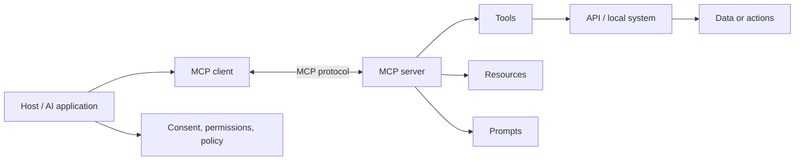

# MCP Ecosystem — Connector & Tool Map

## Purpose
Understand MCP as an interoperability protocol for AI hosts, clients, and servers, and choose integrations with clear security boundaries.

## Current specification snapshot
The official specification currently identifies MCP as an open protocol connecting LLM applications with external data and tools. It uses JSON-RPC 2.0 and describes Hosts, Clients, and Servers. The 2026-07-28 specification is a significant evolution; implementation details must be version-pinned rather than copied from older tutorials.

## Conceptual architecture

## Roles and capabilities
| Role / feature | Function |
|---|---|
| Host | Application that owns user context, model, and policy |
| Client | Connector instance communicating with a server |
| Server | Exposes capabilities and handles requests |
| Tools | Actions/functions a model can request |
| Resources | Context/data that can be exposed to host/model |
| Prompts | Reusable prompt templates/workflows |
| Extensions | Optional protocol extensions, negotiated and supported explicitly |

## Integration choices
| Pattern | Use case | Risks / trade-offs |
|---|---|---|
| Local stdio server | Desktop/local tool, process isolation | Process lifecycle, package supply chain, local permissions |
| Remote MCP over HTTP | Hosted/shared service, scalable deployment | Auth, TLS, network exposure, tenant isolation |
| Direct REST/OpenAPI | Existing API, simple integration | Custom tool schema and orchestration |
| Custom wrapper | Domain-specific tool or missing connector | Ongoing maintenance and testing |

## Current protocol notes (spec 2026-07-28)
- The protocol core uses stateless, self-contained requests.
- HTTP routing may use protocol headers; verify exact version-specific requirements.
- List results include caching hints.
- Authorization has hardening changes; issuer validation and client metadata are important.
- Tasks and MCP Apps are extensions, not automatically available in every client/server.
- Legacy transport/features may be deprecated; avoid basing new implementations on older examples without checking migration docs.

## Security model and integration controls
MCP does not replace the application's authorization and safety policy. The official specification emphasizes user consent, control, data privacy, and careful tool authorization.

Start with:
- Read-only scopes and least privilege.
- Restrict tools, repositories, folders, databases, and projects to the minimum needed.
- Separate credentials for each integration.
- Review server origin, publisher, code, dependencies, and update mechanism.
- Treat tool descriptions, retrieved resources, and outputs as untrusted.
- Explicit approval for consequential side effects.
- Secret storage outside repository.
- Logging/audit trail with sensitive-data minimization.
- Test revocation and failure handling.

## Risk tiers
| Tier | Example | Control |
|---|---|---|
| 0 | Public search/docs | Usually auto within limits |
| 1 | Read private data | Scoped authorization and privacy review |
| 2 | Create/edit records | Confirmation or constrained permissions |
| 3 | Delete, publish, deploy, send, purchase | Explicit approval |
| 4 | Irreversible/high impact | Manual action plus verification |

## Connector selection checklist
- Is it an official or well-maintained server?
- Which protocol/spec versions and transports are supported?
- What permissions are requested? Is read-only available?
- Where does code execute and who maintains it?
- How are credentials stored, rotated, and revoked?
- Are tool schemas and outputs validated?
- Does the host enforce policy independently of the server?
- Can activity be audited?
- What is the fallback if the server/provider is unavailable?

## Recommended build order
1. One trusted read-only server.
2. Confirm scopes, data exposure, and revocation.
3. Test prompt injection through returned content.
4. Add one narrow write action with approval.
5. Add monitoring and version-pinned deployment.
6. Expand connector count only when each adds measurable value.

## Related maps
- [AI assistant stack](ai-assistant-stack.md)
- [AI Agent & tool-calling architecture](ai-agent-tool-calling.md)
- [Self-hosted AI assistant](self-hosted-ai-assistant.md)
- [Automation ecosystem](automation-ecosystem.md)
- [Cybersecurity fundamentals](cybersecurity-fundamentals.md)

## Sources
See the source records in maps-index.json. The sources were checked on 2026-11-24.

## Status
Draft map with an initial official-source audit. Verify current protocol, SDK, client, and server compatibility before implementation.
