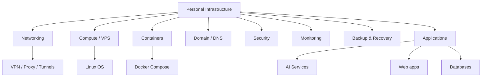

# Personal Infrastructure — Source-Audited Practical Map

## Goal
Operate personal and project infrastructure safely, affordably, and reproducibly. This map is an architecture and operational checklist, not a substitute for host-specific review.

## System landscape

## Layers
| Layer | Responsibilities | Key decision |
|---|---|---|
| DNS/domain | Names, records, ownership | Keep ownership/recovery independent |
| Network | Firewall, routing, proxy, tunnels | Minimize exposed ports |
| Compute | CPU, RAM, disk, OS, region | Size to workload and failure tolerance |
| OS | Updates, packages, users, systemd | Prefer supported stable release |
| Container runtime | Images, Compose, isolation | Pin/track image updates and configuration |
| Reverse proxy | Routing, TLS, access policy | Centralize external exposure |
| Applications | Services and workloads | Separate sensitive apps and scopes |
| Storage | Volumes, database, files | Persistent data and recovery plan |
| Security | Auth, secrets, permissions | Least privilege and no secrets in Git |
| Monitoring | Health, logs, alerts | Detect resource exhaustion and failures |
| Recovery | Backups, restore, runbooks | Verify restore with a test |

## OS operating principle
For general production and personal server workloads, prefer the current Debian stable release unless a documented requirement favors another supported OS. Read the official Debian Reference for package management, system administration, security, and backup/recovery concepts. Avoid mixing Debian suites or repositories casually.

## Container deployment principles
- Use Docker Engine and Compose from official installation documentation where Docker is the selected runtime.
- Keep Compose files in version control; exclude secrets and local overrides.
- Pin versions or digests for critical services where reproducibility matters; define an update process.
- Use health checks, restart policy, resource limits where supported, and explicit persistent volumes.
- Do not assume containerization automatically provides strong security isolation.
- Before publishing ports, review host firewall and cloud firewall rules.

### Docker networking caution
Docker documentation warns that published container ports may bypass UFW/firewalld rules in some configurations. Validate the actual host firewall behavior and configure rules using Docker-supported firewall integration; do not assume that a host firewall alone blocks all published container ports.

## Data, secrets, and backup
- Identify stateful data: databases, uploads, configuration, secrets, certificates, and application state.
- Keep credentials in a secret manager or protected host files; never commit them.
- Back up application data consistently. Database backup should use a database-aware procedure.
- Store at least one backup separately from the host/provider.
- Define recovery objectives (RPO: acceptable data loss; RTO: recovery time).
- Test restoration to a clean environment and record the result.

## Minimum host inventory
For each host record:
- Provider, region, OS/release, CPU/RAM/disk
- Owner, purpose, criticality, renewal/billing
- IPs, domains, exposed ports
- Services, Compose projects, volumes
- Backup destination, last restore test
- Update/maintenance window
- Access identities and recovery path

## Deployment checklist
1. Define purpose, business criticality, and threat model.
2. Choose host resources from measured workload needs.
3. Verify OS support and plan updates.
4. Prepare least-privilege access and secure SSH.
5. Configure provider and host firewall.
6. Deploy application using a versioned Compose configuration.
7. Add TLS, authentication, and narrowly scoped access.
8. Configure secrets and persistent storage.
9. Set backup, monitoring, and alerting.
10. Test restart, failure, and restore.
11. Document rollback and runbook.
12. Review after major changes.

## Change-management rule
Do not change an existing production host, firewall, proxy, DNS, or port without a written change plan, backup/recovery path, and explicit approval. Prefer isolated staging for experiments.

## Related
- [Cybersecurity fundamentals](cybersecurity-fundamentals.md)
- [Self-hosted AI assistant](self-hosted-ai-assistant.md)
- [Software delivery / DevOps](software-delivery-devops.md)

## Sources
Source records in maps-index.json. This is an initial official-documentation audit; host-specific controls, backups, firewall behavior, and service exposure still require verification.

## Status
Draft; initial source audit completed. Do not interpret this as an audit of any existing VPS or production environment.
