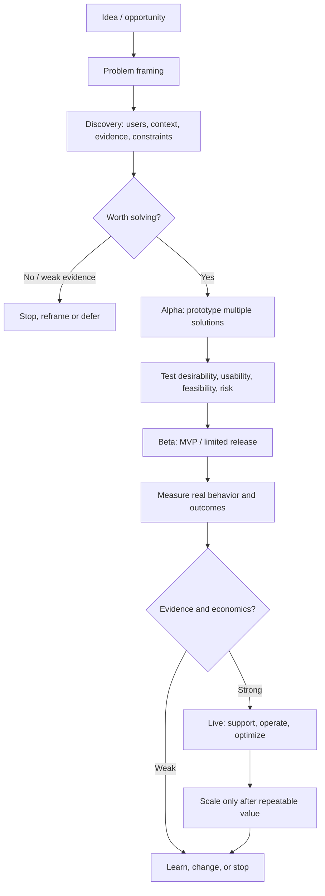

# Product Development — Problem to MVP Map

## Goal
Move from a real user problem to a tested, usable, viable product while minimizing wasted development and premature scale.

**Core principle:** decide what to learn before deciding what to build. Treat the MVP as a test of the riskiest value and feasibility assumptions—not a feature checklist.

## Lifecycle

## 1. Problem framing
Write a concise problem statement:
- **Who:** user, buyer, operator, or beneficiary.
- **Context:** when, where, and under what constraints.
- **Need / job:** what they are trying to accomplish.
- **Current behavior:** existing process, workaround, competitor, or substitute.
- **Pain:** cost, time, risk, frustration, lost revenue, or failure.
- **Evidence:** observed behavior/data, not only opinions.
- **Scope:** what is included and excluded.
- **Outcome:** measurable improvement that would matter.

Avoid solution-first problem statements such as “we need an app.” Reframe them as a user goal or measurable problem.

## 2. Discovery — reduce problem uncertainty
Research:
- User groups, buyer/operator differences, and context.
- Current journey and alternatives.
- Frequency, severity, and cost of the problem.
- Constraints: technology, operations, regulation, accessibility, supply, distribution, and economics.
- Existing data, support logs, search, sales, usage, or complaint evidence.
- Who is not represented and may be excluded.

Methods: contextual observation, interviews, user journey mapping, existing-data analysis, competitor/substitute review, and small surveys when the question and sample support them.

**Interview discipline:** ask about recent concrete experiences and actions. Avoid leading questions, hypothetical willingness-to-pay, and asking users to approve your idea.

Discovery exit:
- A bounded problem and target segment.
- Evidence that the problem exists and matters.
- A clear set of critical assumptions and constraints.
- A decision: stop/reframe, or proceed to alpha.

## 3. Assumption map and risk order
List assumptions across:
- **Desirability:** user needs/wants the outcome and will change behavior.
- **Usability:** users can understand and complete the task.
- **Feasibility:** technology, process, supplier, and delivery can work.
- **Viability:** revenue, cost, margins, and cash flow can work.
- **Safety/legal:** product/service is permitted and risks can be controlled.
- **Adoption:** distribution, trust, access, and switching barriers are manageable.

Prioritize assumptions by uncertainty × impact × cost of being wrong. Test the most dangerous assumption early, before expensive build or procurement.

## 4. Alpha — explore and prototype
Generate several solution directions. Use the lowest-cost prototype that can answer the current question:
- Paper or sketch.
- Clickable mock-up.
- Landing page or offer.
- Concierge/manual service.
- Technical proof-of-concept.
- Sample product or process pilot.
- Wizard-of-Oz test where automation is simulated transparently.

Prototype is for learning. It may be incomplete, temporary, or discarded. Test with representative users and observe task completion, errors, comprehension, and behavior.

Alpha exit:
- Evidence supports a plausible solution.
- Major usability and feasibility risks are understood.
- The initial product scope and test criteria are defined.

## 5. MVP — minimum real value and test
Define the MVP from the hypothesis:
- User segment and problem.
- Value proposition and expected behavior.
- Minimum end-to-end capability needed to deliver/test value.
- Explicit exclusions.
- Acceptance criteria.
- Measurement instrumentation.
- Safety, privacy, accessibility, and regulatory baseline.
- Operational support and rollback plan.

Do not confuse:
- **MVP:** a minimum product or service that can deliver and test value.
- **Prototype:** a learning artifact that may not be production-ready.
- **Pilot:** controlled deployment with limited users, volume, geography, or risk.
- **Feature-complete product:** broader capability; often unnecessary for initial validation.

## 6. Experiment design
For each experiment, record:
| Field | Definition |
|---|---|
| Hypothesis | Specific falsifiable statement |
| Risk | What is most uncertain or costly if wrong? |
| Test | Method and exposure |
| Population | Target participants/customers and recruitment |
| Baseline | Current behavior or comparator |
| Metric | Primary and guardrail metrics |
| Threshold | Minimum result to continue |
| Duration/sample | Planned time, sample, and stopping rule |
| Cost | Money, labor, and opportunity cost |
| Bias | Selection, measurement, novelty, or demand bias |
| Decision | Continue, iterate, pivot, or stop |

A test should be capable of disproving the hypothesis. Avoid vanity metrics and post-hoc success criteria.

## 7. Metrics and outcome measurement
Choose metrics based on product type and lifecycle:
- **Activation / time-to-value:** reaches the first meaningful outcome.
- **Task success:** completes the task accurately and without help.
- **Conversion:** performs the intended next action.
- **Retention / repeat use:** returns or repeats when the need recurs.
- **Revenue / willingness to pay:** actual purchase, paid pilot, or renewal—not only stated intent.
- **Quality:** errors, complaints, refunds, defects, or service failures.
- **Cost to serve:** labor, infrastructure, material, support, and distribution.
- **Outcome:** measurable improvement in the user’s situation.
- **Guardrails:** safety, privacy, accessibility, satisfaction, and unwanted consequences.

Define numerator, denominator, cohort, timeframe, source, and owner. Compare to baseline. Avoid metrics that reward activity without user value.

## 8. Viability and operational feasibility
Before broader launch, estimate or measure:
- Unit economics and contribution margin.
- Customer acquisition / channel cost.
- Capacity, bottlenecks, delivery and support.
- Supply, quality, compliance and service reliability.
- Cash requirements, working capital, and break-even.
- Return, complaint, defect, and failure handling.
- Competitive substitutes and switching costs.
- Scalability and operational complexity.

Use sensitivity analysis. An uncertain input should be a range and a test plan—not a precise forecast.

## 9. Beta / controlled launch
Release to a limited scope when:
- MVP delivers the defined value.
- Core workflow and acceptance tests pass.
- Data, security, legal, safety and accessibility risks are controlled.
- Monitoring, support, incident response and rollback are ready.
- Metrics and feedback mechanisms are working.
- A clear cohort, volume, or launch boundary is set.

A beta is not a license to expose users to unmanaged risk. Set launch and stop criteria.

## 10. Live product and improvement
- Monitor outcomes and quality continuously.
- Review feedback, support and failure patterns.
- Conduct small research rounds as the product changes.
- Prioritize problems by user impact, risk, cost, and evidence.
- Improve onboarding, reliability, accessibility and support.
- Track technical debt and operating cost.
- Retire features that do not create enough value.
- Reassess assumptions as context and competition change.

## 11. Decision gates
| Gate | Evidence needed | Decision |
|---|---|---|
| Discovery | Problem, user, context and constraints are understood; problem evidence | Stop/reframe or Alpha |
| Alpha | Tested prototype, solution evidence, feasibility risks | Continue, change or stop |
| MVP/Beta | End-to-end value, acceptance criteria, instrumented experiment | Pilot, iterate or stop |
| Controlled launch | Safety/quality, support, reliability, economics, launch boundaries | Expand or pause |
| Scale | Repeatable value, retention/demand, economics, operational capacity | Scale, optimize, or constrain |
| Live | Outcomes, incidents, feedback and change evidence | Continuous improvement or sunset |

## 12. Practical one-page product brief
- Product / project:
- Target segment:
- User / buyer / operator:
- Problem statement:
- Current alternatives:
- Evidence of problem:
- Desired outcome:
- Value proposition hypothesis:
- Critical assumptions:
- Riskiest assumption:
- Experiment:
- Primary metric:
- Guardrail metrics:
- Success / stop threshold:
- MVP scope:
- Explicit non-goals:
- Constraints / risks:
- Cost and economics:
- Next decision and date:

## 13. Common failure modes
- Building before understanding the problem.
- Treating interview compliments as demand evidence.
- Confusing a prototype with a production-ready MVP.
- Adding features before testing the core value.
- Measuring downloads, visits or output volume without meaningful outcome.
- Defining success after seeing results.
- Ignoring non-users, accessibility or the end-to-end service.
- Underestimating support, operations, compliance, and distribution.
- Scaling acquisition before retention or repeatable value.
- Treating assumptions and forecasts as verified facts.

## Source audit — 2026-11-24
- [GOV.UK User Research in Discovery](https://www.gov.uk/service-manual/user-research/user-research-in-discovery) — identify users, goals, current behavior, pain points, and needs before solution design/build.
- [GOV.UK User Research Introduction](https://www.gov.uk/service-manual/user-research/how-user-research-improves-service-design) — user research throughout lifecycle; focus on outcomes and real behavior; iterative small research cycles.
- [GOV.UK Learning about User Needs](https://www.gov.uk/service-manual/user-research/start-by-learning-user-needs) — research needs through discovery, alpha, beta and live.
- [GOV.UK Discovery Phase](https://www.gov.uk/service-manual/agile-delivery/how-the-discovery-phase-works) — problem definition, user context, constraints, opportunities and evidence before commitment.
- [GOV.UK Making Prototypes](https://www.gov.uk/service-manual/design/making-prototypes) — prototype to explore/test before committing to production build.
- [Government Design Principles](https://www.gov.uk/guidance/government-design-principles) — user needs, data-informed design, iteration, inclusion and service outcomes.

**Audit limitation:** Government service guidance is useful methodology, but it is not a universal product framework or proof of commercial viability. No specific product/customer research or experiment was performed by this map audit.

## Related maps
- [Business Validation](business-validation.md)
- [Economics & Decision Making](economics-decision-making.md)
- [Food Manufacturing System](food-manufacturing-system.md)
- [AI Assistant Stack](ai-assistant-stack.md)
- [Research & Evidence Workflow](research-evidence-workflow.md)
