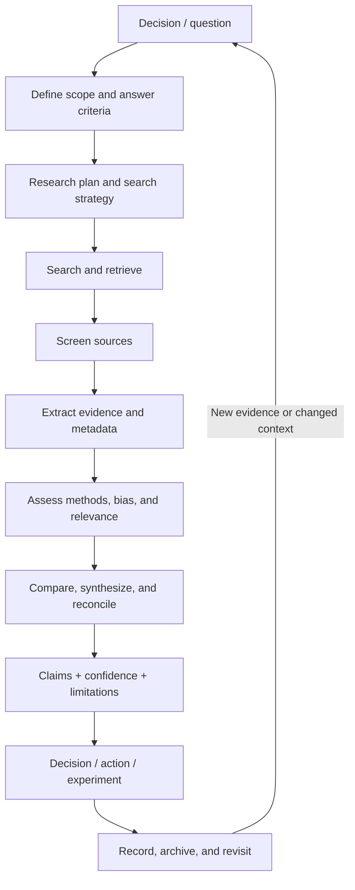

# Research & Evidence Workflow — Map

## Goal
Answer questions, compare alternatives, and make decisions using evidence that is traceable, appropriately qualified, and reproducible enough for the stakes.

**Rule:** Research is not a pile of links. It is a documented path from a question to claims, evidence, synthesis, uncertainty, and action.

## Workflow

## 1. Question framing
Write a question that can be answered:
- What decision or uncertainty is the research intended to resolve?
- What population, system, product, time, geography, or context is in scope?
- What outcomes or properties matter?
- What would count as a useful answer?
- What evidence is needed, and how strong must it be for the stakes?

Use structured frameworks when they fit:
- **PICO/PECO:** population, intervention/exposure, comparator, outcome — health or causal questions.
- **SPIDER:** sample, phenomenon, design, evaluation, research type — qualitative/mixed questions.
- **Engineering:** operating conditions, requirements, constraints, failure modes, acceptance criteria.
- **Business:** segment, problem, behavior, offer, alternatives, economics, decision threshold.

## 2. Research plan
Before searching, record:
- Question and scope.
- Sources/databases/sites to search.
- Search terms, synonyms, filters, and date range.
- Inclusion/exclusion criteria.
- Evidence types expected.
- Planned extraction fields.
- Decision criteria.
- Search date and researcher.
- Any protocol changes and why.

For high-stakes or systematic work, pre-specify the plan to reduce selection bias. Exploratory research can be iterative, but document how the question or method changed.

## 3. Search and source acquisition
Search broadly enough to avoid a single-source view:
- Official standards, regulations, documentation, datasets and primary records.
- Original research.
- Systematic reviews and credible syntheses.
- Technical reports, professional guidance and credible institutions.
- Secondary sources for discovery/context.
- Community reports for lived experience, troubleshooting or emerging signals.

Search with synonyms, alternate terms, older names, and contradictory/negative terms where relevant. Follow citation trails. Record search strings and dates for important work.

## 4. Source triage and quality appraisal
Assess each source against the question—not merely the reputation of the publisher.

| Dimension | Ask |
|---|---|
| Authority | Who produced it? Are they qualified? |
| Evidence type | Primary data, experiment, official rule, synthesis, opinion, anecdote? |
| Methods | Design, sample, measurement, analysis, controls, inclusion criteria? |
| Relevance | Does the population, product, setting, or version match our case? |
| Recency | Is it current for a fast-changing topic? |
| Bias / conflicts | Funding, incentives, selective reporting, author interests? |
| Reproducibility | Are methods, data, code, or parameters sufficiently disclosed? |
| Limitations | What can it not support? |
| Independence | Are multiple sources actually based on the same underlying evidence? |

Do not count repeated news stories or reviews of the same study as independent confirmation.

## 5. Evidence types and contextual hierarchy
Evidence strength depends on the question. A practical starting guide:

| Question type | Usually strongest starting evidence |
|---|---|
| Current law/regulation | Official legal text, regulator interpretation, jurisdiction-specific authority |
| API/software behavior | Current official documentation, changelog, reproducible test |
| Scientific causal effect | Well-designed randomized studies where feasible, systematic synthesis, then other designs according to bias/relevance |
| Diagnostic/prognostic accuracy | Validated studies and systematic reviews appropriate to the target population |
| Engineering performance | Specification plus independent/reproducible testing under relevant conditions |
| Market demand | Observed customer behavior, paid pilots, sales/retention, then direct interviews and surveys |
| User experience | Target-user observation, usability testing, user reports and measured task outcomes |
| Historical claim | Primary archival records, scholarly synthesis and corroboration |

This table is a heuristic. There is no universal ranking for all research questions.

## 6. Claim ledger
Build a ledger for consequential claims. Keep claim-level provenance instead of only source-level bookmarks.

| Claim ID | Claim | Evidence / source | Evidence type | Context / date | Confidence | Caveat / contradiction |
|---|---|---|---|---|---|
| C-01 | | | | | | |

For each claim:
- Link to the exact source and, when possible, section/table/page/paragraph.
- Record source publication date and access date separately.
- Capture key quantitative values with units, population, comparator and time frame.
- Keep direct quotation short and clearly marked; otherwise paraphrase.
- Record conflicting evidence, not just supporting evidence.
- Distinguish what the source states from your interpretation.

## 7. Confidence and uncertainty
Use simple labels consistently:
- **Verified:** directly confirmed by authoritative evidence or a reproducible test, within the stated scope.
- **Likely:** converging evidence supports it, but important uncertainty remains.
- **Hypothesis:** plausible explanation or proposed relationship requiring a test.
- **Unknown:** evidence is missing, conflicting, inaccessible, or insufficient.

Confidence is claim-specific, not a badge for an entire document. Do not use “verified” for a broad claim when only a narrow example was checked.

For estimates, state assumptions, range, sensitivity, and method. Avoid false precision.

## 8. Synthesis
1. Group sources by claim, method, context and evidence type.
2. Compare findings and methods, not just conclusions.
3. Identify agreement, disagreement, heterogeneity, and evidence gaps.
4. Check whether disagreement is explained by population, measurement, context, date, or method.
5. Distinguish correlation from causation.
6. Consider alternative explanations and negative evidence.
7. Avoid double-counting sources that share the same underlying dataset.
8. State the scope of the conclusion and what could change it.

For systematic reviews, use a specialist methodology appropriate to the topic; this map is not a replacement for a review protocol or reporting standard.

## 9. Decision translation
A research answer should end with:
- **Finding:** what the evidence currently supports.
- **Confidence:** why and within what scope.
- **Unknowns:** what remains unresolved.
- **Implication:** how the evidence changes the decision.
- **Action:** test, implement, defer, monitor, or stop.
- **Reversal trigger:** what new evidence would change the recommendation.

Decision confidence may differ from factual confidence because risk tolerance, cost, values, and reversibility also matter.

## 10. Reproducibility and research record
For work that may be revisited:
- Save query strings, search date, source links and retrieval context.
- Preserve relevant source copies where legally and ethically allowed; prefer stable links/DOIs and archival records.
- Record version numbers, model IDs, code, data, parameters, calculations and transformations.
- Keep raw inputs separate from derived analysis.
- Make exclusions and protocol deviations explicit.
- Maintain a change log.
- Protect private, personal, copyrighted, or sensitive information.
- Do not claim a result is reproducible unless someone can actually reproduce the relevant steps.

## 11. Research output checklist
- [ ] Decision/question and scope are clear.
- [ ] Search method and date recorded.
- [ ] Sources are relevant and sufficiently diverse.
- [ ] Source quality and bias assessed.
- [ ] Important claims have claim-level sources.
- [ ] Conflicting evidence and negative findings considered.
- [ ] Fact, estimate, interpretation, and recommendation separated.
- [ ] Confidence and limitations stated.
- [ ] Calculations, units, assumptions and methods visible.
- [ ] Action and reversal triggers identified.
- [ ] Research record can be revisited or reproduced.

## 12. Review triggers
Revisit research when:
- New evidence or data arrives.
- A standard, law, API, price, product or version changes.
- A major source is corrected, retracted or superseded.
- The decision context, target population or operating conditions change.
- A test or real-world outcome contradicts the current conclusion.

Suggested cadence: fast-changing facts 30–90 days; durable methods and background 180–365 days; decision-critical facts verify before action.

## Source audit — 2026-11-24
- [Cochrane Handbook for Systematic Reviews of Interventions](https://www.cochrane.org/handbook) — health-intervention review methods, question framing, search/selection, extraction, risk of bias, synthesis and interpretation. Domain-specific; not a universal research manual.
- [National Academies — Reproducibility and Replicability in Science (2019)](https://nap.nationalacademies.org/25303) — reproducibility/replicability, rigor, transparency, and factors contributing to inconsistent research results.

**Audit limit:** Spot-check of authoritative methodology resources. This map is a practical cross-domain workflow, not a full systematic-review standard or formal evidence grading tool.

## Related
- [Knowledge Management](knowledge-management.md)
- [AI Models & Providers](ai-models-providers.md)
- [Business Validation](business-validation.md)
- [Economics & Decision Making](economics-decision-making.md)
- [Decision map template](../templates/decision-map.md)
